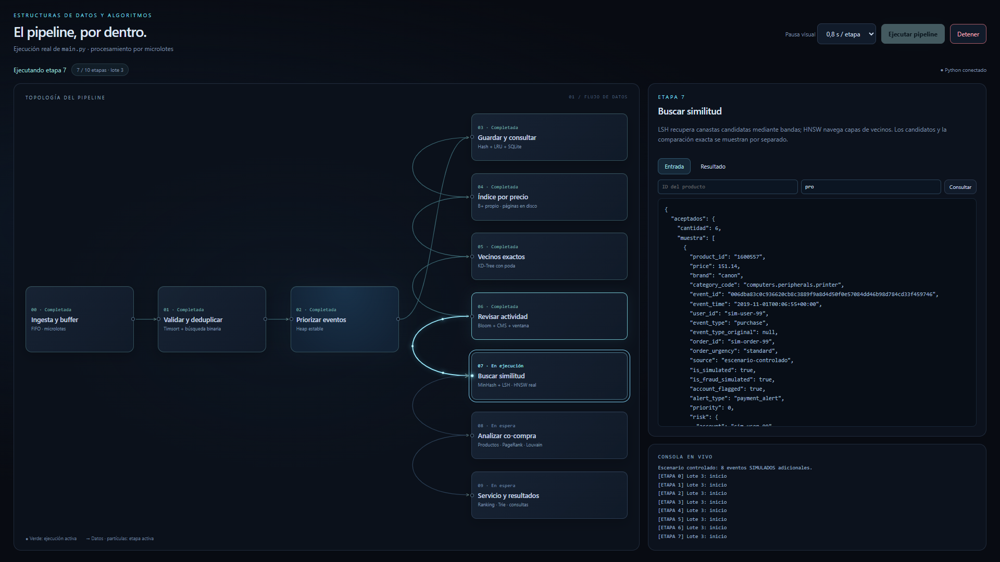
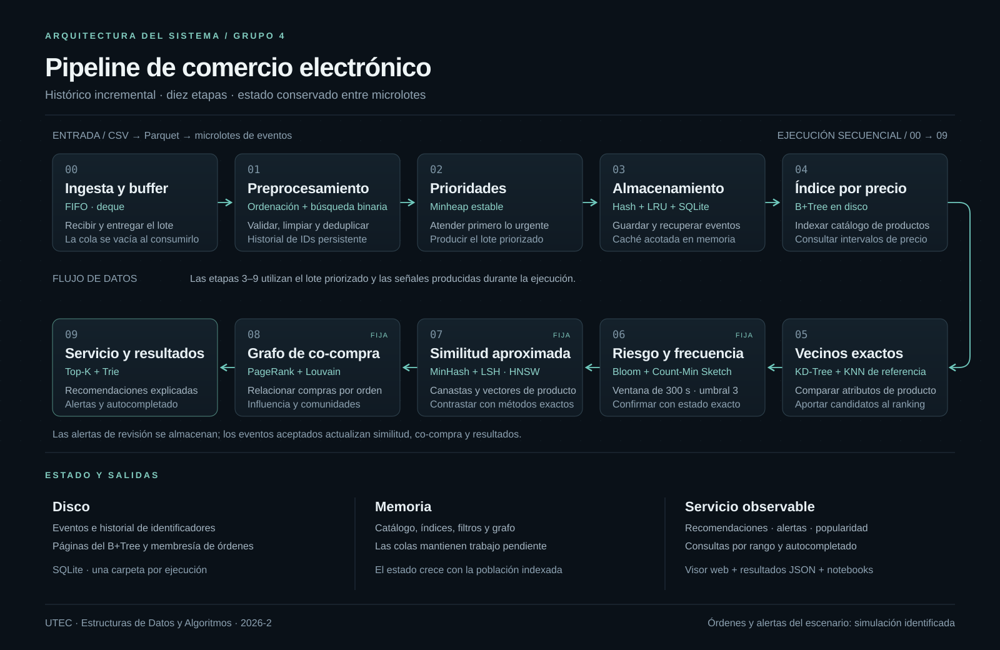

# Pipeline de comercio electrónico

Estructuras de Datos y Algoritmos · Maestría en Ciencia de Datos e Inteligencia Artificial · **UTEC 2026-2**

Procesa eventos de navegación y compra en microlotes a través de diez etapas. Mantiene índices entre lotes y produce recomendaciones, alertas verificadas, autocompletado y rankings. El visor web muestra las entradas y salidas de cada etapa durante la ejecución.

[Informe PDF](docs/Proyecto_Final_Grupo4.pdf) · [Presentación](docs/Presentacion_Grupo4.pptx) · [Guía técnica](docs/GUIA_TECNICA.md)



*Visor local con pausa de 0,8 s por etapa. Las partículas indican la etapa activa; el panel permite inspeccionar sus datos.*

## Instalación y ejecución

Requiere Python 3.12 o superior, salvo 3.14.1 por una restricción de NetworkX. En PowerShell, desde la raíz:

```powershell
python -m venv .venv
.\.venv\Scripts\Activate.ps1
python -m pip install -r requirements.txt
```

Descarga el CSV de [eCommerce behavior data](https://www.kaggle.com/datasets/mkechinov/ecommerce-behavior-data-from-multi-category-store), guárdalo en `data/raw/` y prepara los datos. También puedes indicar otra ruta con `--csv`:

```powershell
python -m src.convert_to_parquet --csv data/raw/2019-Nov.csv --rows 1000
python main.py
```

Abre **http://127.0.0.1:8765**. Selecciona **0,8 s/etapa** y pulsa **Ejecutar pipeline** para seguir el flujo. **Detener** interrumpe el procesamiento; `Ctrl+C` cierra el servidor. Cada ejecución guarda su salida en `output/results/last_pipeline.json`.

Por defecto se leen los 1.000 eventos completos en lotes de 500 y se añaden ocho eventos simulados identificados con `is_simulated`, para demostrar co-compra y alertas. Para procesar solo el histórico, sin web:

```powershell
python main.py --sin-visor --sin-escenario
```

### Si el visor no abre

El mensaje **Visor listo** aparece después de comprobar por HTTP el servidor, la página, el CSS y el JavaScript. No comprueba el funcionamiento del navegador. La dirección `127.0.0.1` corresponde a la computadora donde se ejecuta Python; no requiere publicar el sitio ni configurar el router.

Mantén la terminal de `main.py` abierta y ejecuta en otra terminal:

```powershell
python main.py --diagnostico
```

El diagnóstico informa si el servidor responde, su PID y el estado del pipeline. Si responde pero la página no abre, prueba la misma URL en Chrome o Edge. Si hay un puerto ocupado, el programa identifica el problema; puedes cerrar el visor anterior o elegir otro puerto:

```powershell
python main.py --port 8766
# En otra terminal, para comprobar ese mismo puerto:
python main.py --diagnostico --port 8766
```

Abre la URL que indique el programa. Los mensajes y errores técnicos se guardan localmente en `output/logs/visor.log`. Al pedir soporte, comparte la salida del diagnóstico y el error del log, revisando previamente cualquier ruta o dato que no quieras compartir. Al pulsar `Ctrl+C`, el servidor se cierra y la URL deja de responder.

## Arquitectura



El motor ejecuta las etapas de **0 a 9** por cada lote. Las colas entregan trabajo pendiente; los índices conservan información para consultas posteriores. Los eventos que requieren revisión se guardan y los aceptados actualizan similitud y co-compra. [Abrir diagrama en alta resolución](docs/images/pipeline_architecture.png).

## Notebooks

En VS Code selecciona el kernel **Python de `.venv`** y ejecuta las celdas en orden.

| Notebook | Para qué sirve |
| --- | --- |
| [01 · Demostración del pipeline](notebooks/01_pipeline_demo.ipynb) | Ejecuta el sistema; permite elegir lote y etapa, inspeccionar datos y consultar recomendaciones y alertas. |
| [02 · Evaluación experimental](notebooks/02_benchmarks.ipynb) | Presenta tiempos, memoria, calidad y escalabilidad de los resultados guardados, con tablas y gráficos comparativos. |

## Experimentos

La preparación de 10M genera también los cortes de 1K, 10K, 100K y 1M. Los CSV y Parquet permanecen fuera de Git.

```powershell
python -m src.convert_to_parquet --csv data/raw/2019-Nov.csv --rows 10000000
python benchmarks.py --sizes 1K 10K 100K 1M 10M --max-entities 2000
python -m unittest discover -s tests -v
```

Los resultados incluidos contienen **100 repeticiones en 1K** y una exploración de las escalas mayores con **una repetición y poblaciones analíticas acotadas**. Esta última no acredita una evaluación completa de todas las estructuras con 10M elementos. El notebook muestra los tamaños efectivos y las limitaciones. El benchmark mide sin las pausas del visor.

## Estructura y entregables

Los datos de entrada se guardan en `data/`, el código de `src/` los procesa y los resultados se escriben en `output/`. El visor de `web/` permite observar esa ejecución.

| Carpeta | Qué contiene | Cuándo consultarla |
| --- | --- | --- |
| `src/` | El motor del sistema: `stream_reader.py` lee los lotes, `pipeline.py` coordina el procesamiento y `etapa_0_...py` a `etapa_9_...py` implementan las estructuras y algoritmos. | Para entender o modificar cómo se procesan los eventos. |
| `web/` | El servidor local (`server.py`) y los archivos de la interfaz en `static/`: HTML define la página, CSS su apariencia y JavaScript sus interacciones. | Para cambiar el visor, las animaciones o la comunicación con Python. |
| `notebooks/` | Dos cuadernos ejecutables: el primero demuestra el pipeline y el segundo analiza las mediciones experimentales. | Para explorar resultados paso a paso con tablas, gráficos y selectores. |
| `tests/` | Pruebas automáticas de las estructuras, la preparación de datos y el servidor. Comprueban, por ejemplo, que se eliminen duplicados y que los índices devuelvan resultados correctos. | Para verificar que un cambio no haya roto el funcionamiento del sistema. |
| `docs/` | El informe PDF, la presentación y la guía técnica. `images/` contiene la captura del visor y el diagrama que aparecen en este README. | Para revisar los entregables y la explicación del diseño. |
| `data/` | Los CSV originales en `raw/`, los cortes Parquet preparados y las bases SQLite generadas por ejecución en `runtime/`. Se conserva localmente y está excluida de Git. | Para colocar el dataset o inspeccionar los datos persistidos. |
| `output/` | Mediciones, gráficos y resultados producidos por el código. Las subcarpetas se detallan a continuación. | Para consultar lo que produjo una ejecución o un experimento. |

Dentro de `output/`:

| Subcarpeta | Qué guarda |
| --- | --- |
| `benchmarks/` | `report.json` con las mediciones de 1K y los gráficos comparativos. Incluye tiempos, memoria, calidad, parámetros y repeticiones. |
| `escalabilidad/` | `report.json` y gráficos de la exploración de 10K, 100K, 1M y 10M. Registra las poblaciones efectivas y los recortes; su alcance se explica en la sección Experimentos. |
| `results/` | `last_pipeline.json`, con contadores, recomendaciones y alertas de la última ejecución del pipeline. Se genera localmente y no se sube a Git. |
| `logs/` | `visor.log`, con arranques, actividad y errores técnicos del servidor y del pipeline. Es local, tiene rotación por tamaño y está excluido de Git. |

Los archivos de la raíz sirven para iniciar el trabajo: `main.py` ejecuta el pipeline y abre el servidor del visor; `benchmarks.py` mide los algoritmos; `requirements.txt` enumera las librerías necesarias.

Al trabajar localmente también pueden aparecer `.venv/` (el entorno Python con las librerías), `tmp/` (auxiliares y respaldos de trabajo) y `__pycache__/` (caché automática de Python). Están excluidas de Git y no forman parte del entregable. Las carpetas de resultados locales se crean cuando se ejecutan los procesos correspondientes.

La [guía técnica](docs/GUIA_TECNICA.md) desarrolla los contratos entre etapas, las estructuras seleccionadas, la metodología experimental y las referencias bibliográficas.

## Responsabilidades del equipo

| Integrante | Etapas | Aporte asignado |
| --- | --- | --- |
| Jesús Ricardo Delgado Alvarado | 0, 1, 2 | Ingesta, validación, deduplicación y prioridades |
| Erik Rogers Poma García | 3, 4 | Almacenamiento, caché LRU e índice B+ persistente |
| Mentor Alexis Naquiche Ventura | 5, 6 | KD-Tree, referencia exacta y filtrado probabilístico |
| Guillermo Diego Calderón Canchanya | 7, 8, 9 | Similitud aproximada, grafo y servicio de resultados |

Docente: Heider Sánchez Enríquez.
